<div align="center">

# My AI Trading

**An open research workbench for crypto traders.** It watches the markets, explains what the data shows, argues with your trade ideas, and keeps every number honest about where it came from.

[](https://github.com/XKeviNguyen/my-ai-trading/actions/workflows/ci.yml)


-41CD52?logo=qt&logoColor=white)
[](.github/workflows/ci.yml)


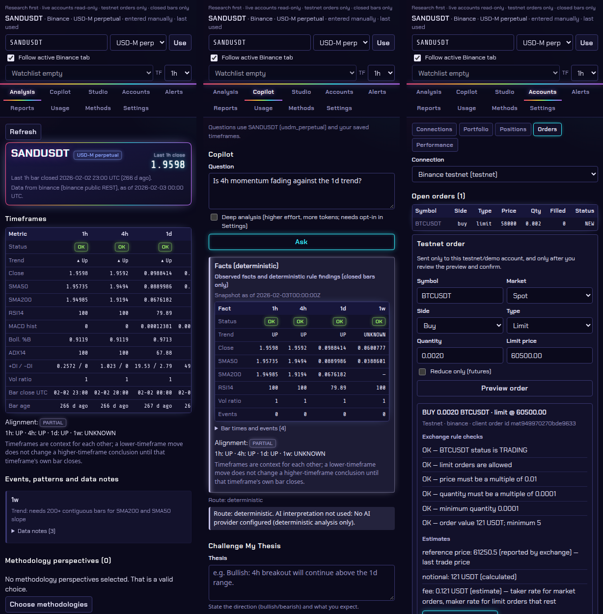

<sub>Chrome side panel with synthetic demo data. Left to right: multi-timeframe analysis, Copilot facts, a testnet order preview with exchange-rule checks.</sub>

</div>

> [!IMPORTANT]
> **Research first, and not financial advice.** Market analysis needs no account. Connecting an exchange is optional. Live accounts are **read-only**, and orders can only go to **exchange testnets**, after you confirm each one. The AI can never place an order, and nothing here promises profit.

---

## Contents

- [What it does](#what-it-does)
- [Screenshots](#screenshots)
- [Feature overview](#feature-overview)
- [Architecture](#architecture)
- [Workflows](#workflows)
- [Database](#database)
- [API surface](#api-surface)
- [Tech stack](#tech-stack)
- [Security model](#security-model)
- [Engineering decisions](#engineering-decisions)
- [Quality and testing](#quality-and-testing)
- [Repository layout](#repository-layout)
- [Quick start](#quick-start)
- [Learn more](#learn-more)

## What it does

Ask most "AI trading" tools *"should I buy?"* and you get a confident answer with nothing behind it. My AI Trading answers different questions:

| Question | How the app answers it |
|---|---|
| **What is the data actually showing?** | Indicators, levels and events on **closed candles only**, side by side for every timeframe |
| **What supports my idea, and what contradicts it?** | *Challenge My Thesis* lists evidence for and against, hidden assumptions, unknowns, and the prices that would prove you wrong |
| **Does this trading method even apply here?** | 20 trader-inspired profiles, each checked against its own timeframe and data needs before it is used |
| **What would this rule have done?** | Plain-English rules compiled into a safe typed rule language, then dry-run or backtested with fees, slippage and funding |
| **What does my account actually hold?** | Read-only balances, positions and risk across Binance, Bybit, OKX and Interactive Brokers (paper) |

Every alert and answer shows its evidence: the values, the candle they came from, and the condition that would invalidate them.

## Screenshots

| Portfolio and risk (side panel) | Strategy Studio (side panel) |
|---|---|
| 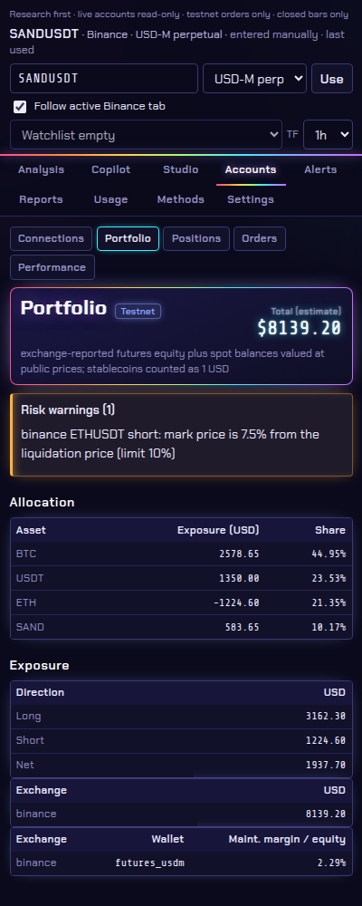 | 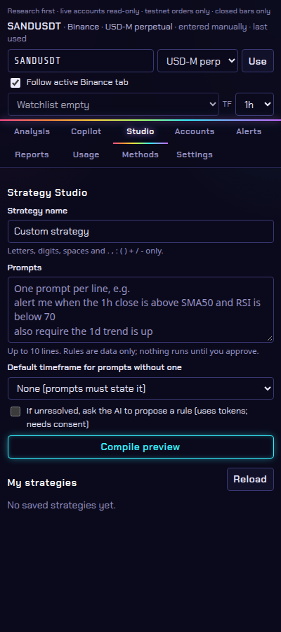 |

| Desktop app: analysis | Desktop app: portfolio |
|---|---|
| 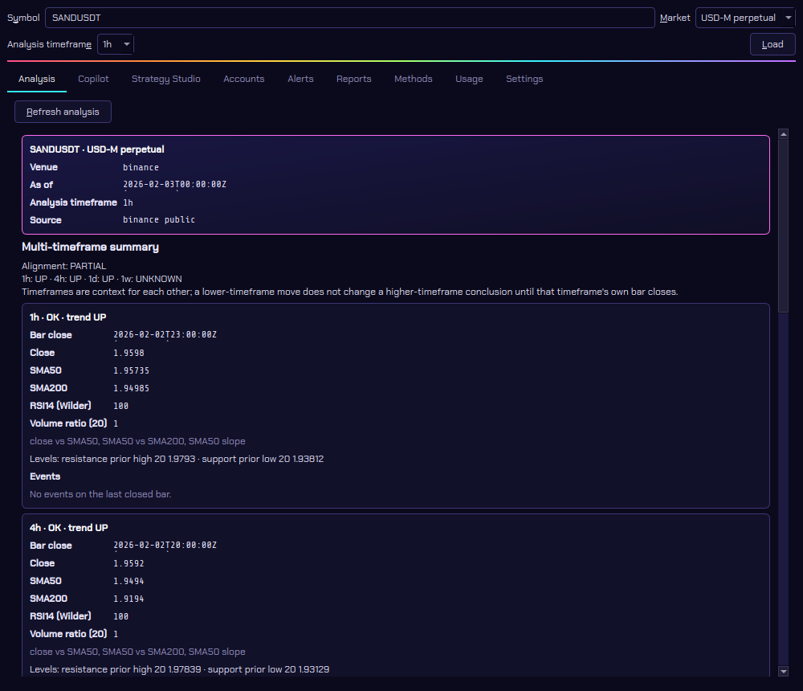 | 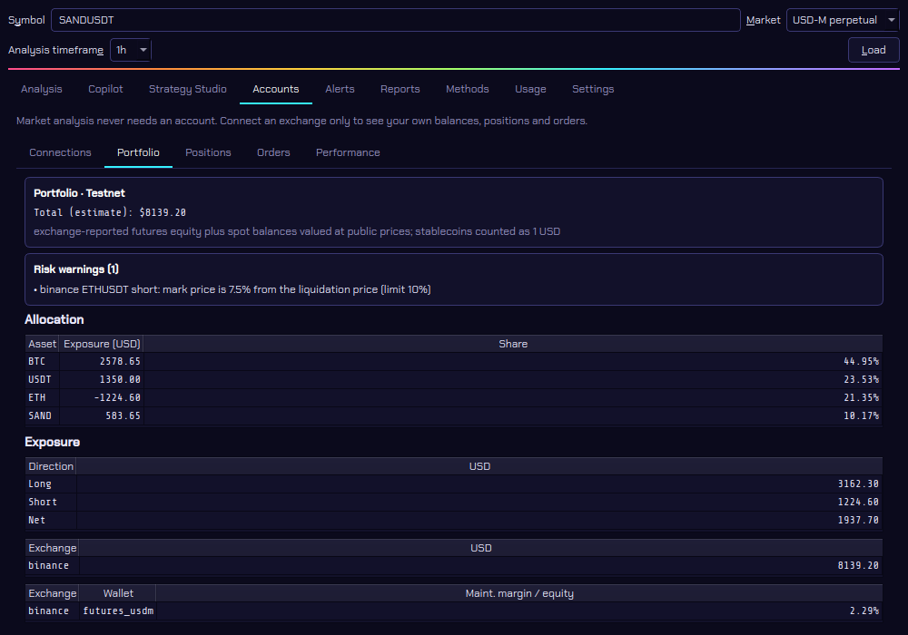 |

<sub>All screenshots use synthetic data from the project's test fixtures and a simulated testnet account, not real markets.</sub>

## Feature overview

✅ available · 🧪 experimental (works, limited or not yet validated) · 🗓️ planned

| Area | Feature | Status | Highlights |
|---|---|:-:|---|
| **Market analysis** | Multi-timeframe engine | ✅ | 1m to 1W plus calendar months. SMA, EMA, RSI, MACD, Bollinger Bands, ADX/DI, ATR, volume ratio, prior highs and lows |
| | Monitoring and alerts | ✅ | Runs once per newly closed candle per timeframe. Duplicate-proof alerts, backoff, stale-data detection, quiet hours |
| | Chart patterns | 🧪 | VCP, cup and handle, head and shoulders, flags, triangles, wedges, Darvas boxes, each with an invalidation level |
| | Live streams | ✅ | Binance kline WebSocket streams wake the monitor the moment a candle closes |
| **Copilot and strategies** | Copilot | 🧪 | Facts always come from the engine. Optional AI interpretation is clearly labeled |
| | Challenge My Thesis | ✅ | Evidence for and against, assumptions, unknowns, falsification levels |
| | 20 trader profiles | 🧪 | Native, Hybrid, Adapted or Custom modes. Seven have rule checks (Minervini, Weinstein, Turtles, Darvas, Williams, Raschke, Brandt) |
| | Strategy Studio | ✅ | Plain English to a typed rule. Preview, dry-run, approve one exact version, deactivate. A clause the compiler cannot map exactly stays UNRESOLVED instead of being guessed |
| **Vision and ML** | Chart screenshots | 🧪 | OpenCV candle geometry and Tesseract OCR: **99.53%** of price-axis labels read exactly on a held-out **synthetic** benchmark (not yet tested on real screenshots) |
| | ML research lab | 🧪 | scikit-learn and LightGBM in walk-forward folds with purge gaps, calibration and leakage checks |
| | Backtesting | ✅ | Next-bar fills, fees, slippage, perpetual funding, ATR stops; always labeled hypothetical |
| **Accounts** | Exchange connections | 🧪 | Binance, Bybit, OKX by API key; Interactive Brokers paper through IBKR's own gateway |
| | Portfolio and risk | 🧪 | Value, allocation, exposure, margin use, distance to liquidation, risk warnings with your own limits |
| | Testnet Trading Mode | 🧪 | Off by default. Exchange-rule preview, per-order confirmation, reconciliation of unknown outcomes |
| | Performance from fills | 🧪 | Win rate, expectancy, profit factor, drawdown, fees |
| | One-click exchange sign-in (OAuth) | 🗓️ | Blocked by provider approval: each exchange requires partner approval |
| **Clients** | Chrome extension | ✅ | Side panel next to the Binance chart; detects the symbol from the page address |
| | Desktop app | 🧪 | Native PySide6 app with the same features, theme and fonts |
| **Cost control** | AI budget and cache | ✅ | Monthly token and USD budgets, usage dashboard, free repeat answers from a candle-keyed cache |

## Architecture

The core is one Python engine. Both clients are thin: they render what the local API returns and never compute numbers themselves.

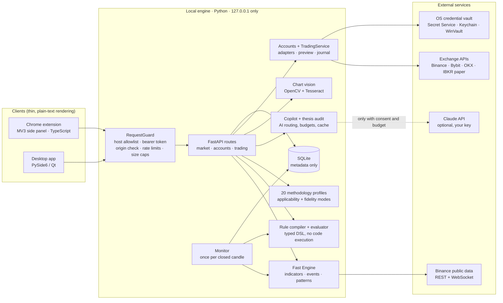

| Layer | Responsibility | Key modules |
|---|---|---|
| **Clients** | Render, collect input, never invent numbers | `extension/src/views/*.ts`, `desktop/my_ai_trading_desktop/views/*.py` |
| **Guard** | Reject before parsing: host, token, origin, size, rate | `api.py` `RequestGuard` |
| **Market core** | Closed candles, indicators, events, patterns, multi-timeframe snapshots | `domain.py`, `market.py`, `engine.py`, `indicators.py`, `patterns.py` |
| **Strategy** | Prompt to typed rule, evaluation, methodology applicability | `compiler.py`, `rules.py`, `methodology.py`, `perspectives.py`, `strategies.py` |
| **AI** | Facts first, optional LLM, budgets, cache, thesis audit | `copilot.py`, `thesis.py`, `chartvision.py`, `ml.py` |
| **Accounts** | Credentials, adapters, analytics, testnet orders | `accounts/credentials.py`, `accounts/adapters/*`, `accounts/analytics.py`, `accounts/trading.py` |
| **Persistence** | Settings, strategies, alerts, usage, journal; never secrets | `store.py` |

## Workflows

### 1. From a candle to an insight

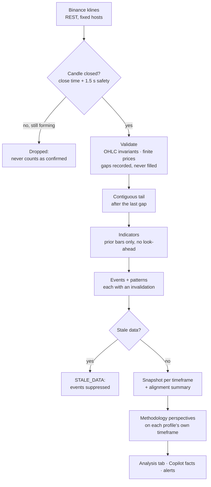

### 2. Monitoring and alerts

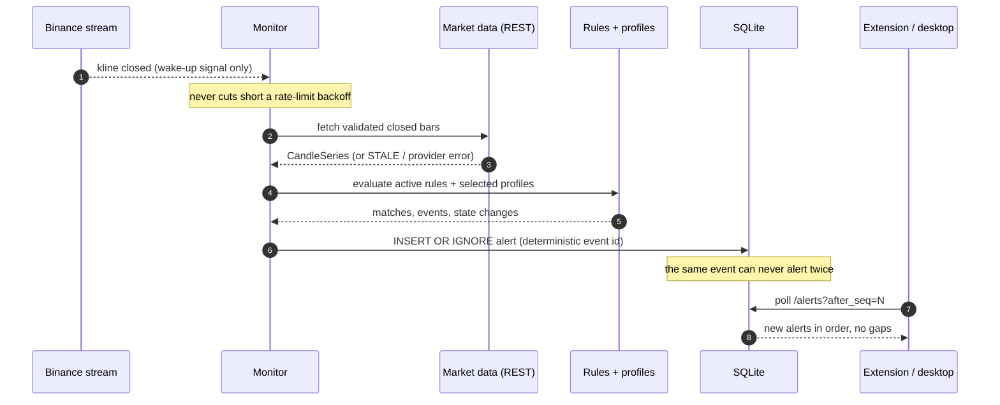

### 3. How AI is used, and when it is not

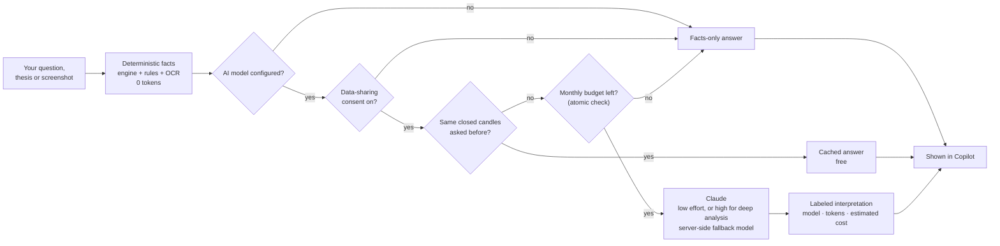

### 4. A testnet order, step by step

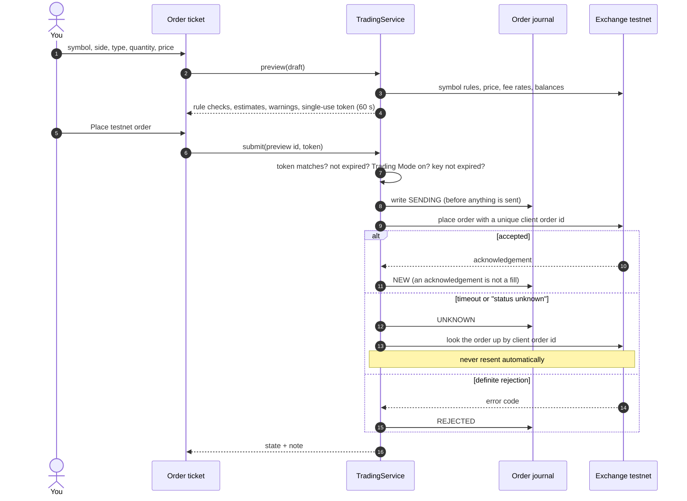

**Order states.** The state is the last one the exchange confirmed, and it only moves forward: an older or slower answer never moves it back, and the check runs inside one SQL statement. A lookup that does not find the order changes nothing; it is recorded separately as "not listed", and the app says "do not place it again". You can cancel any order that is not final. You can mark an order resolved only if the exchange never acknowledged it, only after you checked the exchange's order history, and never while it is being sent. A later exchange report replaces that mark.

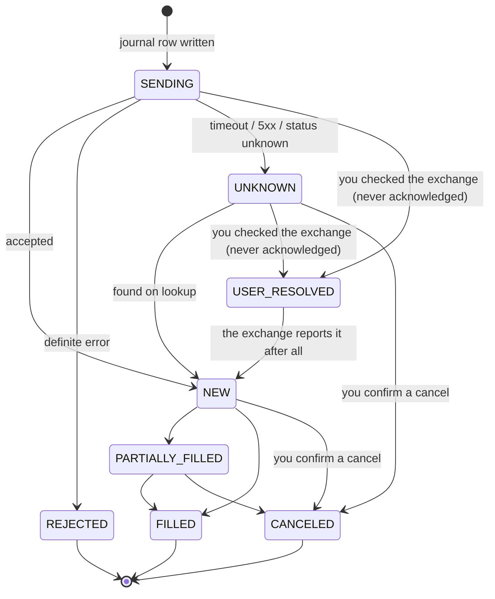

### 5. An exchange key's lifetime

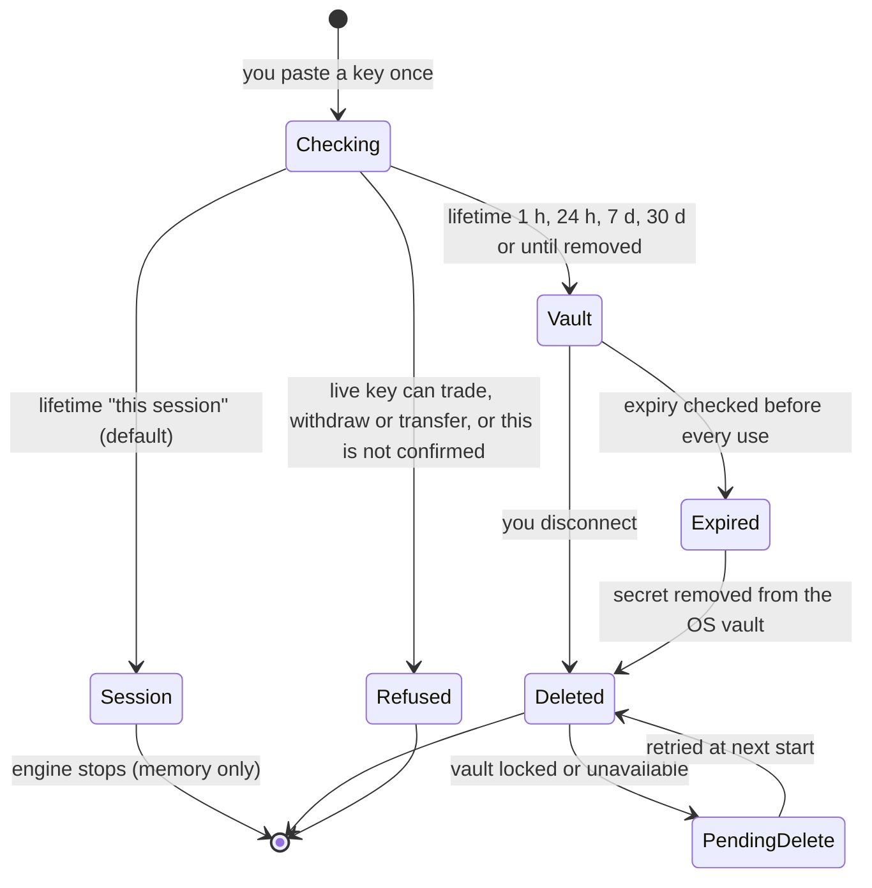

## Database

One local SQLite file (`~/.local/share/my-ai-trading/app.db`, owner-only permissions). Every row carries a `user_id`, so the schema is ready for multiple users. **API secrets are never stored here.** Only connection metadata and a 4-character key hint are, and a test scans the raw database bytes to prove it.

```mermaid
erDiagram
    settings {
        TEXT user_id PK
        TEXT json "watchlist, timeframes, budgets, risk limits"
        INTEGER updated_at
    }
    strategies {
        TEXT id PK
        TEXT user_id
        TEXT name
        TEXT kind "CUSTOM or ADAPTED"
        TEXT parent_methodology
        INTEGER created_at
    }
    strategy_versions {
        TEXT strategy_id PK,FK
        INTEGER version PK
        TEXT rule_json "typed rule, never code"
        TEXT rule_hash "approval is bound to this hash"
        TEXT prompts_json
        TEXT status "DRAFT, ACTIVE or ARCHIVED"
        INTEGER approved_at
    }
    alerts {
        TEXT event_id PK "deterministic: no duplicates"
        TEXT user_id
        TEXT instrument_key
        TEXT timeframe
        TEXT event_type
        INTEGER bar_open_time_ms
        TEXT payload_json
    }
    reports {
        TEXT id PK
        TEXT user_id
        TEXT instrument_key
        TEXT title
        TEXT json
    }
    ai_usage {
        INTEGER id PK
        TEXT feature
        TEXT model
        INTEGER input_tokens
        INTEGER output_tokens
        REAL cost_usd
        TEXT status
    }
    ai_cache {
        TEXT key PK "hash of question + closed-candle times"
        INTEGER expires_at
        TEXT payload_json
    }
    exchange_connections {
        TEXT connection_id PK
        TEXT user_id
        TEXT meta_json "exchange, environment, expiry, permissions, key hint"
    }
    trading_orders {
        TEXT client_order_id PK
        TEXT connection_id FK
        TEXT environment "testnet only"
        TEXT request_json
        TEXT state
        INTEGER lookups
    }
    cooldowns {
        TEXT key PK
        INTEGER last_bar_open_ms
    }
    monitor_state {
        TEXT key PK
        TEXT value
    }

    strategies ||--o{ strategy_versions : "has versions"
    exchange_connections ||--o{ trading_orders : "journal"
```

| Stored | Where | Never stored |
|---|---|---|
| Settings, strategies, alerts, reports, AI usage, AI cache, order journal | SQLite | API secrets and passphrases |
| Exchange connection metadata (no secrets) | SQLite | Full API keys (only the last 4 characters) |
| Exchange API secrets (optional, with expiry) | OS credential vault | Any file, browser storage, logs or AI prompts |
| Live account balances and positions | Memory only, about 15 s | Disk |

## API surface

All routes live under `/api/v1` on `127.0.0.1:8765`. Every route except `/health` needs the bearer token. [docs/api/openapi.json](docs/api/openapi.json) is generated from the app by `tools/export_openapi.py`, and a test fails when it drifts.

| Group | Routes | Notes |
|---|---|---|
| **Market** | `GET /snapshot` · `GET /analysis` · `GET /methodologies` · `POST /backtest` | Public data only; provider calls are rate limited |
| **Strategy Studio** | `POST /strategies/compile` · `POST /strategies/dry-run` · `GET/POST /strategies` · `PUT /strategies/{id}` · `POST /strategies/{id}/versions/{v}/approve` · `POST /strategies/{id}/deactivate` | Approval is bound to the exact `rule_hash` you previewed |
| **Copilot** | `POST /copilot/ask` · `POST /copilot/challenge` · `POST /copilot/vision` | Screenshot size checked before decoding |
| **Monitoring** | `GET /alerts?after_seq=` · `GET /monitor/status` | Cursor paging that never skips alerts |
| **Workspace** | `GET/PUT /settings` · `GET/POST /reports` · `GET /reports/{id}?format=markdown` · `GET /usage` | `PUT /settings` needs `If-Match` (the `ETag` from `GET`): 428 without it, 412 if the settings changed meanwhile |
| **Accounts** (private) | `GET /accounts/exchanges` · `GET/POST /accounts/connections` · `DELETE /accounts/connections/{id}` · `GET …/{id}/snapshot` · `…/orders` · `…/fills` · `…/cashflows` · `…/performance` · `GET /accounts/portfolio` · `POST /accounts/cache/clear` | Web pages are refused even with the token; separate rate limit |
| **Trading** (private, testnet) | `GET /trading/consent` · `PUT /trading/mode` · `POST /trading/preview` · `POST /trading/orders` · `GET /trading/orders` · `POST /trading/orders/{id}/reconcile` · `POST /trading/orders/{id}/cancel` · `POST /trading/orders/{id}/resolve` | Stricter rate limit; returns 409 with the reason when refused. |

## Tech stack

| Layer | Technology | Why this choice |
|---|---|---|
| **Engine** | Python 3.11+ (CI on 3.11 and 3.14), FastAPI, Uvicorn, Pydantic | Typed boundaries, fast to test, one language for all the math |
| **Storage** | SQLite (WAL), stdlib `sqlite3` | Local-first, no server to run, atomic updates |
| **Market data** | Binance public REST (stdlib `urllib`), `websockets` | No exchange account needed; fixed hosts, no redirects |
| **Exchange accounts** | Binance, Bybit V5, OKX V5, IBKR Client Portal Gateway | One adapter interface; payloads checked against official docs and SDKs |
| **Credentials** | `keyring` (Secret Service, KWallet, macOS Keychain, Windows Credential Manager) | Secrets stay in the operating system's vault |
| **AI** | Anthropic SDK (Claude), adaptive effort, server-side fallback | Optional; facts never depend on it |
| **Vision** | OpenCV, Tesseract 5 | Local, zero-token screenshot reading |
| **ML** | scikit-learn, LightGBM, numpy | Baselines first; walk-forward validation |
| **Extension** | TypeScript, Chrome MV3 side panel, no framework, no bundler | Small attack surface; text-only DOM builder (no `innerHTML`) |
| **Desktop** | PySide6 (Qt Essentials), Fusion style, bundled fonts | One codebase for Linux, macOS and Windows (tested on Linux so far) |
| **Design** | Neon night theme, Chakra Petch + Share Tech Mono (SIL OFL) | One color per kind of information; text meets WCAG AA contrast |
| **Quality** | pytest, Hypothesis, node:test, GitHub Actions (SHA-pinned) | Property tests for indicators; offline, deterministic suites |

## Security model

| Threat | Defense | Where |
|---|---|---|
| A website calls your local engine | Host allowlist (blocks DNS rebinding), bearer token, CORS only for extensions, private routes refuse any web origin | `RequestGuard` |
| Oversized or malicious requests | Content-Length caps before the body is read; image dimensions checked before decoding | `api.py`, `chartvision.py` |
| Prompt injection into strategies | Prompts compile to a typed rule language; no `eval`, shell or SQL; ReDoS-safe clause limits | `compiler.py`, `rules.py` |
| A live key that can move money | Live keys must be confirmed read-only; unknown permissions are refused | `accounts/service.py` |
| Secrets leaking | `Secret` type never prints; 422 errors never echo input; secrets only in memory or the OS vault; a pre-commit secret guard and a full-history scan in CI | `accounts/credentials.py`, `tools/secret_guard.py` |
| Duplicate or blind orders | Single-use 60 s confirmation, journal before send, reconcile instead of resend, testnet-only checks in both the service and every adapter | `accounts/trading.py`, `accounts/adapters/*` |
| AI acting on its own | No code path from the Copilot to order submission; AI output is labeled and never executed | `copilot.py` |
| Untrusted text in the UI | Text nodes only in the extension; plain-text widgets only in the desktop app, enforced by tests | `extension/src/dom.ts`, `desktop/tests/test_source_safety.py` |

## Engineering decisions

| Decision | Reason |
|---|---|
| **Closed candles only** | A forming candle can still change. Counting it would make signals that disappear. |
| **Numbers come from code, never from the model** | LLMs are good at explaining and bad at arithmetic. The model only interprets engine facts. |
| **Unknown is not "no"** | A missing permission flag, a "not found" order and a 3xx response all mean "not known yet", and are handled as such. |
| **Journal before send, reconcile instead of resend** | After a timeout, an order may or may not exist. Sending it again could double the position. |
| **`Decimal` for money** | Float rounding errors in P&L and fees are unacceptable. |
| **Streams wake the monitor; REST supplies the data** | A lost or duplicated stream message can change *when* a result is computed, never *what* it is. |
| **Every figure carries its provenance** | `exchange_reported`, `derived` or `estimate`, so you know what to trust. |
| **Methodologies run on their own timeframe** | A weekly method stays weekly when you look at an hourly chart, and adaptations are labeled as yours. |

## Quality and testing

Every pull request runs four [CI](.github/workflows/ci.yml) jobs. The CI run shows the current test counts.

| Suite | CI job | What it covers |
|---|---|---|
| Python engine | `python` (3.11 and 3.14) | Indicators (incl. property-based), closed-bar rules, monitor, compiler, API security, credentials, all four adapters, trading flows, analytics, streams, OCR benchmark smoke test, OpenAPI spec drift |
| Chrome extension | `extension` (Node 22) | Type-check, build, API client, error kinds, ID validation, security scan of the built bundle (no `innerHTML`, no remote resources) |
| Desktop app | `desktop` (offscreen Qt) | Offscreen UI integration against the real engine, secret handling, plain-text-only source rules, theme contrast |
| Secret scan | `secret-scan` | `tools/secret_guard.py --history` over every commit reachable from the tested commit |

All suites are offline and deterministic; they use no network and no real accounts.

- **OCR benchmark:** 83.06% → **99.53%** exact reads on 400 held-out synthetic charts (2,970 labels) never used for tuning. Reproduce with `tools/ocr_benchmark.py --split heldout`; method and limits in [OCR_BENCHMARK.md](docs/OCR_BENCHMARK.md).
- **Independent reviews:** read-only "breaker" reviews (security, data, flow, environment, performance, simplicity) run by convention before major merges; nothing enforces them. Each confirmed finding should get a regression test. The latest audit is in [docs/audits](docs/audits/).
- **Codebase size (2026-10-27):** about 10,800 lines of Python, 7,500 lines of Python tests, 4,200 lines of TypeScript, and 4,300 lines of desktop code.

## Repository layout

```text
my-ai-trading/
├── src/my_ai_trading/        Python engine
│   ├── engine.py · indicators.py · patterns.py · market.py · domain.py
│   ├── compiler.py · rules.py · methodology.py · perspectives.py · strategies.py
│   ├── copilot.py · thesis.py · chartvision.py · ml.py · backtest.py
│   ├── monitor.py · streams.py · store.py · api.py · cli.py
│   ├── providers/binance.py  public market data
│   └── accounts/             credentials · service · analytics · trading · api
│       └── adapters/         binance · bybit · okx · ibkr
├── extension/                Chrome MV3 side panel (TypeScript)
├── desktop/                  PySide6 desktop app
├── tests/                    Python test suite
├── tools/                    secret_guard.py · ocr_benchmark.py · export_openapi.py
└── docs/                     product requirements, security, journey, guides
```

## Quick start

You need Linux or macOS with **Python 3.11+** (Ubuntu also needs `sudo apt install python3-venv`). Market data comes from Binance's free public API, so no account is needed.

```bash
git clone https://github.com/XKeviNguyen/my-ai-trading.git
cd my-ai-trading
python3 -m venv .venv
.venv/bin/pip install -e '.[api,vision]'

# Offline demo on clearly labeled synthetic data
.venv/bin/my-ai-trading demo

# Live public data: SANDUSDT perpetual on 1H / 4H / 1D / 1W
.venv/bin/my-ai-trading analyze --symbol SANDUSDT
```

**Run the engine with a client:**

```bash
.venv/bin/my-ai-trading token     # creates a private access token (owner-only file)
.venv/bin/my-ai-trading serve     # local engine on http://127.0.0.1:8765

# Chrome extension
cd extension && npm ci && npm run build      # then load extension/dist as an unpacked extension

# Desktop app
python3 -m venv desktop/.venv-desktop && desktop/.venv-desktop/bin/pip install -e ./desktop
desktop/.venv-desktop/bin/my-ai-trading-desktop
```

**Optional extras:**

| Extra | Install | Enables |
|---|---|---|
| `ai` | `pip install -e '.[ai]'`, then set `MY_AI_TRADING_MODEL` | Copilot interpretation, thesis debate, AI vision |
| `vision` | `pip install -e '.[vision]'` plus `apt install tesseract-ocr` or `brew install tesseract` | Local screenshot analysis |
| `ml` | `pip install -e '.[ml]'` | ML research lab |
| `accounts` | `pip install -e '.[accounts]'` | Exchange connections, OS vault, live streams |

**Try testnet trading:** create a testnet key (Binance spot at testnet.binance.vision, Binance futures demo at demo.binance.com, Bybit testnet, or OKX demo trading). Then open **Accounts → Connections**, choose **Testnet / demo**, and keep the default **This session only**.

## Learn more

| Document | What's inside |
|---|---|
| [Product requirements](docs/PRODUCT_REQUIREMENTS.md) | Vision, personas, acceptance scenarios |
| [Accounts and trading](docs/ACCOUNTS_TRADING.md) | The R8 boundary, design decisions, known limitations |
| [Project journey](docs/JOURNEY.md) | How the project grew, the problems we hit and how we solved them |
| [OCR benchmark](docs/OCR_BENCHMARK.md) | Method, results by condition, failure modes |
| [Chrome extension](docs/EXTENSION.md) · [Desktop app](docs/DESKTOP.md) | Install, permissions, troubleshooting |
| [Security policy](docs/SECURITY.md) · [Roadmap](docs/ROADMAP.md) · [Progress](docs/PROGRESS.md) | Rules, plans and status |

## License and disclaimer

No license has been chosen yet, so all rights are reserved for now. The bundled fonts are under the SIL Open Font License (see `extension/static/fonts/`). This software is for research and education. Markets are risky, past results do not predict future returns, and every decision you make is your own.
